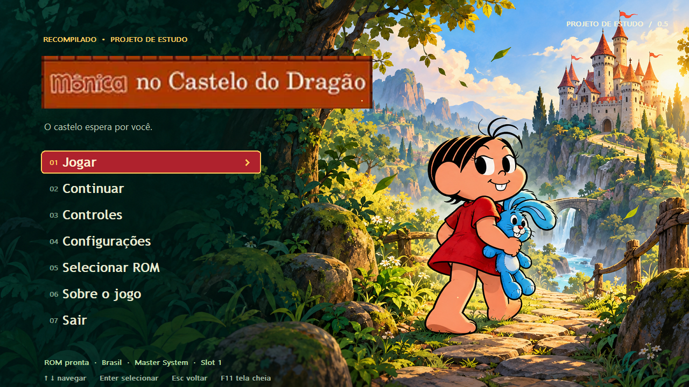
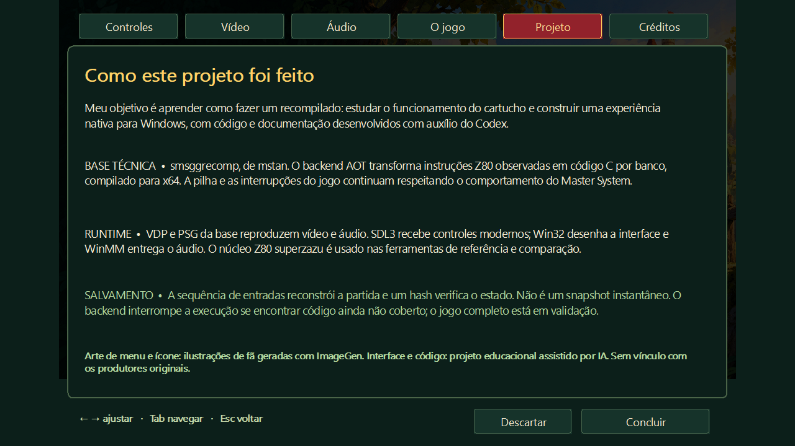
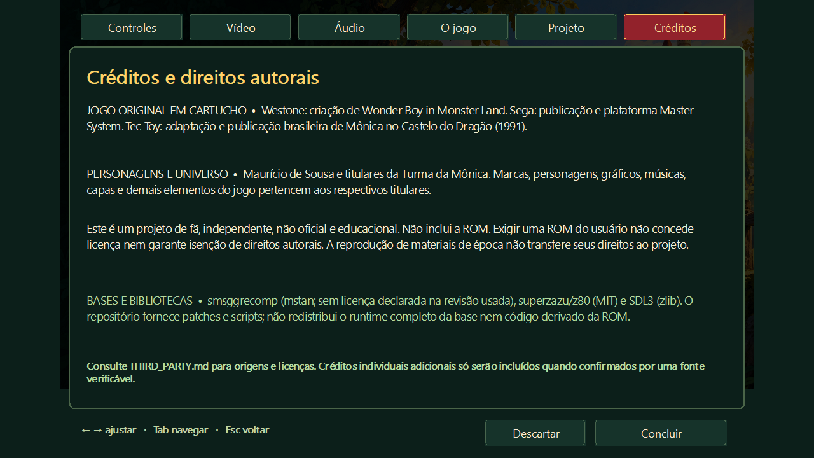
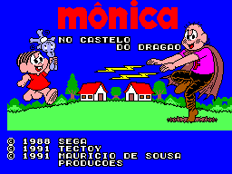
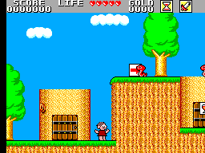
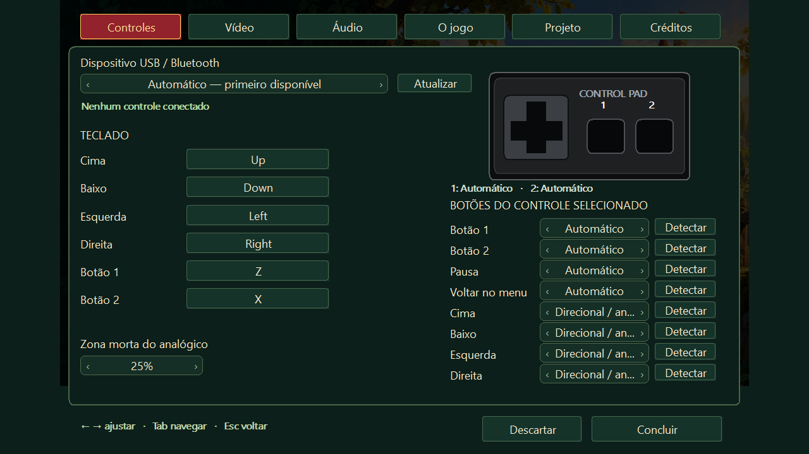
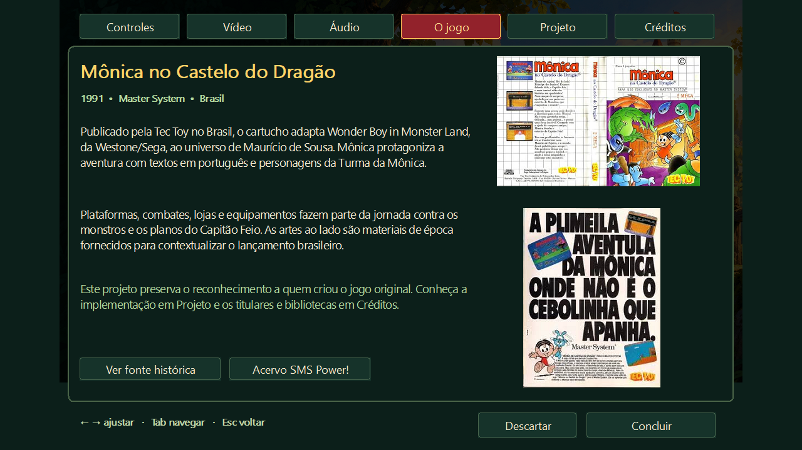

# Mônica no Castelo do Dragão — Recomp

Um projeto de estudo de recompilação estática de um jogo de Master System para Windows x64.

> Meu intuito é aprender como fazer um recompilado de um jogo: estudar a ROM fornecida pelo usuário, traduzir código Z80 e construir uma experiência nativa com menus, controles e salvamento.

**A ROM não acompanha o projeto.** O programa pede uma cópia compatível e só habilita **Jogar** depois de validá-la. O build é experimental; o jogo inteiro ainda não foi validado.



## Interface 0.5

As configurações agora são páginas dentro da janela principal, com abas de Controles, Vídeo, Áudio, O jogo, Projeto e Créditos. A barra de menus do Windows foi removida. Os botões do menu ficam ocultos enquanto essas páginas estão abertas. Há transições de página, destaque de seleção, logo fornecida pelo usuário e ícone incorporado ao executável. Os seletores de valores são componentes próprios, ajustados por setas, mouse ou controle, sem listas do Windows em janelas separadas. Avisos de mapeamento e notificações são exibidos dentro da interface. Concluir aplica as alterações; Descartar preserva a configuração anterior.





## O jogo e sua origem

Lançado pela Tec Toy no Brasil em 1991 para o Master System, **Mônica no Castelo do Dragão** adapta **Wonder Boy in Monster Land**, da Westone/Sega, ao universo de Maurício de Sousa. Mônica protagoniza uma aventura com plataformas, combates, lojas e equipamentos, com textos em português e uma história envolvendo o Capitão Feio. A opção **Sobre o jogo** reúne esse contexto, o propósito educacional e materiais de época.

Referências: [página indicada pelo usuário](https://turmadamonica.fandom.com/pt-br/wiki/M%C3%B4nica_no_Castelo_do_Drag%C3%A3o), [acervo SMS Power!](https://www.smspower.org/Games/MonicaNoCasteloDoDragao-SMS) e os scans de capa/anúncio fornecidos para o projeto. As reportagens sobre **O Resgate** correspondem a outro jogo e não foram usadas como bastidores deste título.

## Capturas

| Tela de título | Jogabilidade |
|---|---|
|  |  |

As imagens do jogo foram geradas pela execução nativa da ROM local. As telas de menu e configurações abaixo foram renderizadas pelo código da interface, em um processo de teste isolado; não são capturas do desktop.

| Controles | Sobre o jogo |
|---|---|
|  |  |

[Vídeo](docs/images/video.png) · [Áudio](docs/images/audio.png) · [Menu sem ROM](docs/images/menu-sem-rom.png)

## Recursos disponíveis

- Menu e pausa com identidade visual própria; prévia da partida durante a pausa.
- ROM externa validada por tamanho/CRC no aplicativo e SHA256 na compilação.
- Jogar e continuar bloqueados sem uma ROM válida.
- Teclado remapeável e seleção de controles via SDL3; modelos USB e sem fio reconhecidos pelo Windows/SDL.
- Perfis padronizados de gamepad e remapeamento manual de botões para joysticks genéricos; zona morta ajustável e reconexão.
- Desenho do controle preto do Master System com os botões e as atribuições.
- Proporções de saída **4:3, 5:4 e 16:9**, com preservação da imagem, escala inteira ou preenchimento por recorte, sem esticar.
- Resoluções de janela de 960 a 3840 pixels de largura, janela/tela cheia sem bordas, filtro nítido/suave, scanlines e brilho.
- Dispositivo de áudio, volume do aplicativo, silêncio, 44,1/48/96 kHz, estéreo/mono e latência.
- Três slots de salvamento por reconstrução determinística, com verificação do estado e rejeição de arquivo corrompido.

**16:9 não aumenta ainda a área real do cenário.** Preservar proporções usa barras quando necessário; preencher recorta bordas. Uma câmera panorâmica com cenário adicional está no [roteiro de desenvolvimento](docs/ROADMAP.md).

A compatibilidade com controles é ampla, mas não é universal: depende dos drivers, do dispositivo e do transporte USB/Bluetooth reconhecido pelo sistema. Foram testados seleção e remapeamento com controles virtuais; a janela também identificou um controle Xbox 360. Falta validar uma variedade de aparelhos físicos.

## Compilação local

Requer Windows x64, PowerShell, Git, CMake e Clang/MinGW com `mingw32-make` no PATH.

```powershell
./build-local.ps1 -RomPath 'C:/caminho/Monica no Castelo do Dragao (Brazil).sms'
./test-local.ps1 -RomPath 'C:/caminho/Monica no Castelo do Dragao (Brazil).sms'
```

O script prepara versões fixas das dependências, aplica os patches, gera o C a partir da ROM e compila localmente. A primeira preparação pode demorar vários minutos. O executável fica em **local-bin/v0.5/MonicaRecomp-v0.5.exe**; mantenha `SDL3.dll` e `assets` junto dele.

ROM suportada: 262144 bytes; CRC32 `01D67C0B`; SHA256 `484FDF3CB85C1BFD1CA938CFD59FD582A06EE20F9F3686BB3DFD1F7A70193086`.

O repositório contém o frontend, os patches e os perfis de endereços. **Não contém ROM, C gerado, runtime copiado da base ou executáveis derivados do jogo.** Dependências são obtidas de seus próprios repositórios durante a preparação.

## Uso

| Ação | Teclado padrão |
|---|---|
| Mover | Setas |
| Botões 1 / 2 | Z / X |
| Pausar ou continuar | Esc |
| Salvar / carregar slot | F5 / F9 |
| Controles | F2 |
| Alternar tela cheia | F11 |
| Navegar / selecionar no menu | Setas, Tab e Enter |

Os comandos são remapeáveis em **Controles**. Em gamepads padronizados, direcional/analógico movem a seleção, o botão sul confirma, o leste volta e Start pausa. O slot é escolhido no menu superior **Slot de save**.

As configurações, saves e `runtime.log` ficam em `%LOCALAPPDATA%/MonicaRecompPrototype`. O aplicativo não altera a ROM. Feche e reabra a versão mais recente após compilar alterações.

## Como a recompilação funciona

A ferramenta decodifica endereços Z80 coletados em roteiros de referência e gera C por instrução e banco. O código é compilado antes de executar o jogo. CALL/RET usam a pilha do Z80 em memória, permitindo retornos calculados que a primeira tradução por funções não tratava corretamente.

O aplicativo usa esse backend AOT e interrompe a sessão se alcançar uma instrução ainda não coberta; não troca silenciosamente para interpretação. Vídeo, áudio, memória e portas do console são modelados pelo runtime. O intérprete permanece apenas nas ferramentas de referência/diagnóstico.

O save atual grava os controles por quadro e reconstrói a sessão em velocidade acelerada ao carregar. A retomada confere um digest do estado. **Ainda não é snapshot instantâneo**, e o carregamento demora mais em sessões longas. O formato atual é versão 2.

Veja [validação](docs/VALIDATION.md), [arquitetura e pendências](docs/ROADMAP.md) e [dependências/créditos](THIRD_PARTY.md).

## Direitos e créditos

Projeto de fã e de aprendizado, sem vínculo oficial com Tec Toy/Tectoy, Sega, Westone ou Mauricio de Sousa Produções. Jogos, personagens, capas, anúncios e screenshots pertencem aos respectivos titulares. Exigir uma ROM não cria isenção automática de direitos autorais.

A base smsggrecomp declara licença ainda não definida. Este repositório não inclui uma cópia dessa base nem a relicencia. O build local também não é um pacote binário público. Consulte [THIRD_PARTY.md](THIRD_PARTY.md) antes de redistribuir componentes.
